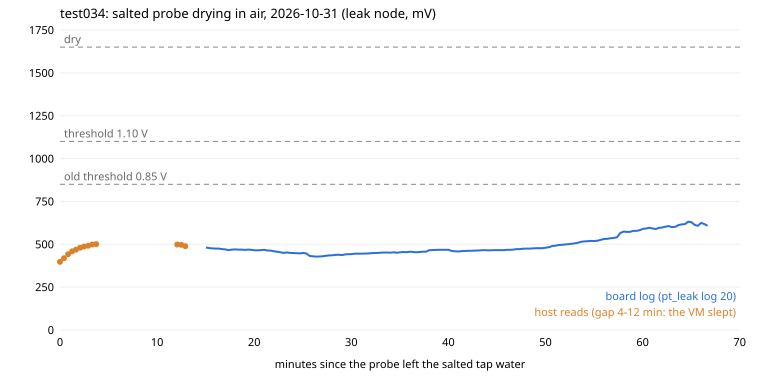

# test034: leak probe wake (ACOMP1) and wet/dry thresholds

Status: **threshold changed to 1.10 V, re-check pending** (2026-10-31): water in a cup, a puddle, hot and salted water
read WET (243-756 mV), but at 0.85 V a pressed wet towel read **dry** (949-952 mV); the user chose 1.10 V (vio_sel 22),
between the towel and a dried salt film (1.17 V): in the code, the board still runs 0.85 V until the drying curve is
dumped. Shorts S1/S2/S3 and the HBN wake on both edges pass (2026-10-22).
Open: the threshold, the salted probe's drying curve (logging on the board), 8 h no-false-wake.

The leak probes S1-S3 pull LEAK_SENS (1 M / 1 M divider from 3V3_SLEEP, 1.65 V dry) down when water bridges them;
ACOMP1 wakes the BL616 from hibernate on that edge. The product's first job.

## Setup

BL616 test firmware: the leak comparator exactly as the product's `leak_init()` (ACOMP1 on ADC0 = IO20, 30 mV
hysteresis, slowest bias); `pt_leak` (node mV by the ADC, comparator state, last wake source), `pt_leak watch [s]`
(one line per comparator change, ADC read after the node settles), `pt_leak sweep` (comparator output against the
node for every reference setting), `pt_sleep <s>` arms the HBN wake on the next comparator edge as `hbn_sleep()`.
Probe sockets shorted by hand (wire across S1/S2/S3). Circuit (SENS.SchDoc): R71 1 M from 3V3_SLEEP and R72 1 M + C109
100 nF to GND on LEAK_SENS; each socket between two 47 k (S1: RB1 to LEAK_SENS, RB2 to GND; S2 RB3/RB4; S3 RB5/RB6).

## Needs (build features and dependencies)

BL616 ACOMP1 (leak), ADC (pt_leak), HBN wake on ACOMP.

(What this test uses; the union over all tests is the feature set the minimal image keeps.)

## Steps

1. Probe resistance sweep across S1 (resistor decade or fixed values 10 k .. 10 M): LEAK_SENS voltage (pt_leak) and
   the comparator's state; the wet/dry threshold in ohms.
2. Real water: tap water, distilled, salt water, a wet towel on the probe tips: resistance and detection.
3. Wake from HBN (test firmware `pt_sleep`, comparators armed): a wet edge wakes within ms; drying (the reverse edge)
   too, as the product expects.
4. All three sockets S1, S2, S3; a probe with a broken wire (open) stays dry.
5. Noise: no false wake over 8 h dry (user 2026-10-23: 24 h overkill, 8 h overnight) (LED drivers, Wi-Fi bursts on the same rail).

## Pass

Wet detected at every water type the product must see, dry never woken falsely in 8 h; wake latency recorded.

## Result

- ACOMP1 reference on this input is **vio_sel x 50 mV; the scaling factor does nothing** (`pt_leak sweep`, factors
  0.25-1 all identical) (2026-10-22). Leak threshold therefore vio_sel 17 = **0.85 V** (wet below ~430 kohm across a
  probe), in leak_wake.c, the test firmware, the K230's PROBE_WET_MV 850, DESIGN.md, firmware/README.md (2026-10-22).
  The USB comparator (ACOMP0, vio_sel 33 x 1 = 1.65 V) is right (2026-10-22).
- Dry: 1648-1650 mV, comparator dry (2026-10-22).
- Hard short S1, S2, S3 (in turn): WET each, settled **247-256 mV** (calculated 262 mV: 94 k to GND against 1 M)
  (2026-10-22). Read the ADC only after the node settles: 50 ms (wet) / 250 ms (dry) (C109 tau 8.6 ms).
- Hand-held contact bounces: several wet/dry changes within ~1 s per touch, the comparator follows each (30 mV
  hysteresis) (2026-10-22).
- HBN armed for going wet: woke **by leak** on an S1 short during a 120 s sleep; HBN slept while wet (armed for going
  dry): the dry edge wakes it (2026-10-22).
- Comparator current not visible at the meter's resolution: rails off, BL616 awake, comparator on 62 mA (2026-10-22).
- Wake latency (estimated, not measured): C109 1.65 V -> 0.85 V trip **7.4 ms** for a hard short (slower for water),
  then the HBN wake path **~15 ms** (test021: 12-16 ms) = ~22 ms to main() (2026-10-22).

- Real water, probe on S1..S3 (2026-10-31, node voltage against the 0.85 V threshold; raw: [water_2026-10-31.log](water_2026-10-31.log)):

  | Case | Node | Comparator |
  |---|---|---|
  | Dry, in air; after each rinse and towel-drying | 1649-1652 mV | dry |
  | Tap water, puddle on the tips | 659 -> 756 mV over 2.5 min, rising (tips polarise, water drying) | WET |
  | Tap water, tips in a cup | 393 mV, settled at 517 mV after 3.5 min | WET |
  | Boiled tap water, hot, in a cup | 243 mV (like a hard short), 408 mV after 4 min | WET |
  | Tap water with salt, in a cup | 390 -> 308 mV over 3.5 min, falling (salt dissolving) | WET |
  | Wet towel (tap water), wrapped, no pressure | 838 -> 892 mV over 1.5 min, rising | WET (hysteresis) |
  | Wet towel, light pressure | 949-952 mV | **dry: missed** |
  | After salt water, rinsed and towel-dried | 1171-1202 mV, rising | dry |
  | Salted probe out of the water, drying in air | 395 -> 500 mV in 4 min, 438 mV low at 28 min, 608-629 mV at 65-67 min ([curve](salt_drying_2026-10-31.svg)) | WET after 67 min |

  - DC through the water polarises the tips: the node rises over minutes in still water (tap: 393 -> 517 mV). Salt
    goes the other way.
  - A wet towel is the marginal case: the comparator stayed WET up to 892 mV (above 0.85 V: the dry edge is higher than
    0.88 V, the hysteresis is wider than 30 mV or the reference is off) and was dry at 949 mV.
  - Distilled water: not required (user, 2026-10-31).
  - A salted probe left in air stays WET for over an hour (the salt film keeps conducting while it holds moisture):
    after a real leak the alarm does not clear by itself soon.

  
  - The host readings have a gap 17:45-17:53: the VM froze 505 s (the Mac slept); since then `pt_leak log` samples on
    the board itself.

Open:
- **Threshold 1.10 V** (user, 2026-10-31: above a pressed wet towel, below a dried salt film so it gives no false
  alarm; 1.20 V would have held the film wet): leak_wake.c ACOMP_VIO_LEAK 22, the test firmware, PROBE_WET_MV 1100,
  mock_server.py, DESIGN.md, firmware/README.md; test_wake.py checks 1000 mV wet, 1200 mV dry. Open: flash the test
  firmware (after the drying-curve dump), re-check the towel and the salt film, the dry trip point (`pt_leak sweep`),
  step 5 (8 h dry) at 1.10 V.
- The dry trip point of the comparator (between 892 and 949 mV seen): `pt_leak sweep` on a towel.
- Salted probe drying curve: still WET after 67 min (608-629 mV, rising ~25 mV per 3 min since ~50 min); the board
  keeps logging (`pt_leak log 20`), next dump for the time to dry (1.10 V, then 1650 mV). Raw:
  [board](salt_drying_board_2026-10-31.log), [host](salt_drying_host_2026-10-31.log).
- Resistor sweep 10 k .. 10 M: not run (the user records voltages, not resistances).
- 8 h dry without a false wake (step 5; the test firmware's evlog counts the wakes).
- Wake latency not measured directly (no edge timestamp on the board).

## Metrics (**MISSING** on every run: skill leakcam-test-metrics)

Probes: current - battery lead, USB out (wake from sleep); voltage - LEAK_SENS (R71/R72 node), 3V3_SLEEP.

| Metric | Value | Top / budget | Note |
|---|---|---|---|
| Boot, power-on -> READY (median of 5) | n/a: a BL616 wake, no K230 boot; RTC/leak wake -> main() 17.3 ms (test021) | target (test022) | longest step: |
| This part's boot share | n/a: no K230 boot | - | |
| Test run time | n/a: hand steps on 2026-10-22, not timed | - | setup (flashing, plugging, waiting) separately |
| wake latency on wet | ~22 ms estimated: C109 trip 7.4 ms (hard short) + HBN wake path ~15 ms (test021); not measured directly (no edge timestamp) | - | % of the top |
| Current idle / during (min / avg / peak) | asleep 35 uA, comparators armed, dry (test031); wet adds ~1.4 uA (calculated: 1 M / 1 M divider from 3.3 V, node 1.65 V dry -> 0.25 V wet; no battery measurements (user, 2026-10-30)); BL616 awake, comparator on, rails off 62 mA (2026-10-22, USB) | floor (test031) | USB-C 1 VBUS meter, D1 off; VBAT at C15 |
| Voltage under load (min) | n/a: no load event; the cell 4.17 V asleep (test031) | cutoff 3.10 V (bug-004) | at the probes above |
| Power, energy per operation | the comparator costs nothing visible (62 mA awake with or without it, 2026-10-22); a leak wake then costs a K230 session (test102) | - | scripts/energy.py |
| Per day | dry: 0 wakes (step 5 open); wet: a session every 10 min until the server says no leak (DESIGN 5.1) | ENERGY.txt line | n per day |
| Temperature die / board (start / peak / end) | n/a: the BL616 alone, nothing heats; not recorded on 2026-10-22 | K230 limit (datasheet) | chip_temp, AHT20 |
| Memory BL616 / K230 (start / min / end), leak | n/a: every HBN wake restarts the BL616 heap (nothing carries over to leak); repeated HBN wakes: test021 | no leak; budget (DESIGN.md) | BL616 `mem`, K230 `free`; repeated operations: mem_leak.py over >= 8 cycles (skill leakcam-test-metrics 5b) |
| Image (sizes) | BL616 test firmware ~150 KB (2026-10-22, before the Wi-Fi set) | minimal image (rule) | the image this run used |
| Compile flags | BL616 test firmware -Os -g (SDK Kconfig default), sections, --gc-sections, no LTO | smallest code (rule) | |
| Features over the minimal image | `pt_leak`, `pt_sleep` (test firmware commands); the comparator setup is firmware/bl616 leak_wake.c's | test008 floor | bytes, boot ms, RAM, current |
| Optimised build (-O3, LTO, -march) | n/a: not an optimisation test (test builds use the default flags: user, 2026-10-29) | the faster one stays | |

## Boot time

HBN wake on a leak to the K230's power-on (with test021): the first part of the leak-to-video time.

## Battery energy

The divider's current wet vs dry (1.65 uA dry; wet up to 3.3 uA): a standing leak raises the sleep current.
